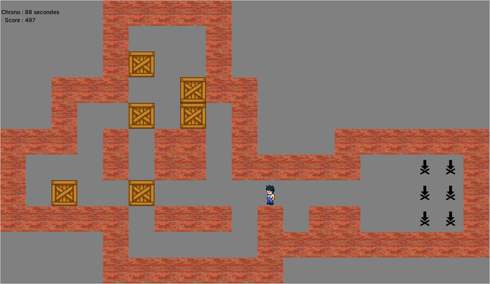

# Sokoban en Python (Tkinter)

Jeu de Sokoban avec interface graphique **Tkinter** : le joueur pousse les caisses sur les cibles avant la fin du chrono.

Projet réalisé en 2024 dans le cours de programmation orientée objet, en **L2 Informatique** à l'**Université de Bretagne Occidentale** (Brest). Le code part d'un squelette fourni par l'enseignant (Alain Plantec) ; j'ai programmé les classes et toute la logique du jeu.



## Fonctionnalités

- Menu : saisie du nom du joueur et choix du niveau (**101 niveaux**, de 0 à 100)
- Déplacement avec les flèches du clavier, poussée des caisses sur les cibles
- Score : 500 au départ, -1 par mouvement, +50 par caisse placée sur une cible
- Chronomètre de 90 secondes
- Scores sauvegardés en JSON (`scores.json`) et affichés dans le menu
- Petites animations : caisse posée sur une cible, mouvement impossible

## Lancer le jeu

Tkinter est nécessaire (sous Ubuntu : `sudo apt install python3-tk`).

```bash
git clone https://github.com/hadi56a/sokoban-python-tkinter.git
cd sokoban-python-tkinter
python3 sokoban.py
```

## Structure du code

| Classe | Rôle |
|---|---|
| `Position`, `Direction` | coordonnées et calcul des déplacements |
| `WharehousePlan` | grille qui contient tous les éléments du niveau |
| `Floor`, `Wall`, `Goal`, `Box`, `Mover` | éléments du jeu (sol, mur, cible, caisse, joueur) |
| `Level` | chargement d'un niveau, touches, score et fin de partie |
| `Panneau` | menu de départ |
| `Chrono` | chronomètre |
| `Score`, `ListeScores` | scores et sauvegarde JSON |

Les niveaux sont au format XSB dans `sokobanXSBLevels.py`.

## Technologies

Python 3, Tkinter, programmation orientée objet, JSON.
